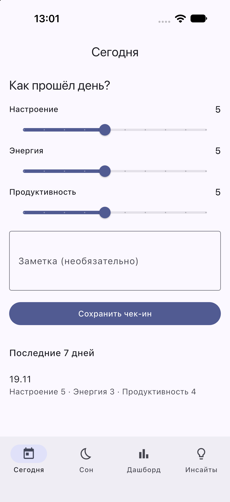
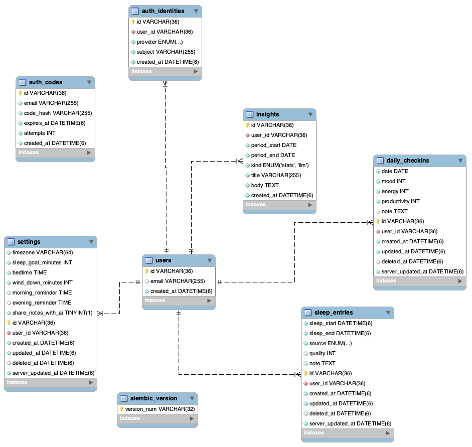

# Life Tracker

An offline-first personal app for tracking quality of life: daily check-ins of mood, energy and productivity, sleep data, and insights based on your own history.

> **Status:** work in progress — week 1 of a 12-week MVP plan. The daily check-in works end to end on the phone; the backend skeleton and database schema are in place.



## Features

**Done**

- Daily check-in: mood, energy and productivity on a 1–10 scale plus an optional note
- One check-in per day: saving again updates the same record
- Last 7 days list that updates live
- Local SQLite database — works fully offline
- Backend skeleton: FastAPI with health check, MySQL in Docker, full data model with migrations

**Planned for the MVP**

- Sign-in with email code, then Google and Apple
- Sync between phone and server
- Sleep tracking via Apple Health with a morning quality rating
- Reminders: wind-down before bed, morning sleep rating, evening check-in
- Dashboard with charts and a home screen widget
- Weekly insights based on statistics (later — an AI assistant using function calling)

## Tech stack

| Layer | Technology |
| --- | --- |
| Mobile app | Flutter 3.47 (Dart), Riverpod, `material_ui` |
| Local database | drift (SQLite) with code generation |
| Backend | FastAPI (Python 3.12), Uvicorn, Pydantic v2 |
| ORM and migrations | SQLAlchemy 2.0, Alembic |
| Database | MySQL 8.4 in Docker Compose |
| Tests | flutter_test with in-memory drift, pytest with FastAPI TestClient |

## Architecture

- **Offline-first.** Every action is written to the local database first; the server is for sync and analytics.
- **Layered app.** UI never touches the database directly: screens → Riverpod providers → repositories → drift.
- **Sync-ready schema.** Synced records carry a client-generated UUID, `updated_at` for last-write-wins conflict resolution, `deleted_at` for soft deletes, and a server-side `server_updated_at` so pull requests never miss changes made offline.
- **Thin routers.** FastAPI routers only parse requests and call services, so the same service functions can later be exposed to an AI assistant as tools.

### Data model



## Project structure

```
life-tracker/
├── app/        # Flutter app
│   └── lib/
│       ├── core/       # app shell, utilities
│       ├── data/       # drift database, repositories, providers
│       └── features/   # one folder per feature: checkin, sleep, dashboard, insights
├── backend/    # FastAPI
│   ├── app/    # models, schemas, routers, services
│   ├── alembic/
│   └── tests/
├── docs/       # ER diagram, screenshots
└── docker-compose.yml
```

## Getting started

**Requirements:** Flutter 3.47+, Xcode (for iOS), Python 3.12, Docker Desktop.

### Backend

```bash
cp .env.example .env            # then set your own passwords
docker compose up -d            # start MySQL

cd backend
python3.12 -m venv .venv
source .venv/bin/activate
pip install -r requirements.txt
alembic upgrade head            # create tables
uvicorn app.main:app --reload   # API docs at http://127.0.0.1:8000/docs
```

### App

```bash
cd app
flutter pub get
dart run build_runner build     # generate drift code
flutter run
```

### Tests

```bash
cd backend && pytest
cd app && flutter test
```